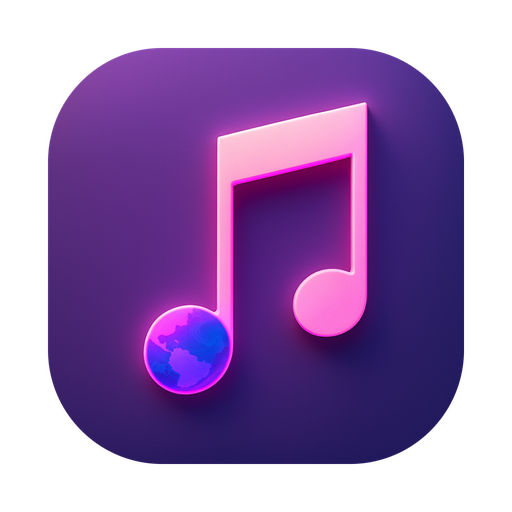
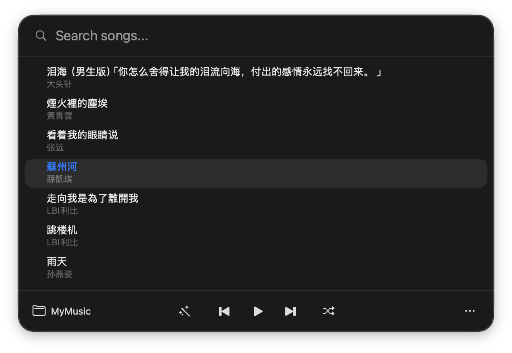
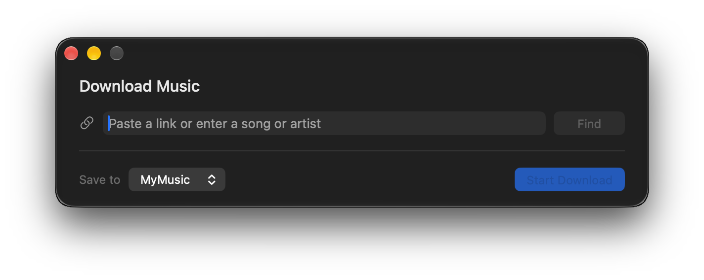

# MacMusicPlayer

<div align="center">
  
  <br />
  <div id="download-section" style="margin: 20px 0;">
    <a href="https://github.com/samzong/MacMusicPlayer/releases/latest" style="text-decoration: none;">
      
    </a>
  </div>
  <p>An elegant and minimalist menu bar music player for macOS (no Dock icon), providing a seamless music playback experience.</p>
  <p>
    <a href="https://www.producthunt.com/products/macmusicplayer?embed=true&amp;utm_source=badge-featured&amp;utm_medium=badge&amp;utm_campaign=badge-macmusicplayer" target="_blank" rel="noopener noreferrer"></a>
  </p>
  <p>
    <a href="https://github.com/samzong/MacMusicPlayer/releases"></a>
    <a href="https://github.com/samzong/MacMusicPlayer/blob/main/LICENSE"></a>
    <a href="https://deepwiki.com/samzong/MacMusicPlayer"></a>
  </p>
</div>

## Requirements

- macOS 13.0 (Ventura) or later

## Installation

### Homebrew (Recommended)

```bash
brew install samzong/tap/mac-music-player
```

### DMG

Download the latest `MacMusicPlayer-arm64.dmg` from the [Releases](https://github.com/samzong/MacMusicPlayer/releases) page.

> **Security Note**: The DMG is ad-hoc signed (no paid Apple Developer account yet). On first launch macOS may warn that the app is from an unidentified developer — right-click the app and select "Open" once to proceed. The Homebrew install above is built from source on your Mac and avoids this entirely.

## Features

- 🎵 Lightweight menu bar player for instant music control
- 🔍 Spotlight-style song picker (⌘F) with instant title, artist, and filename filtering
- 🎨 Native macOS interface with perfect light/dark theme support
- 🌍 Multi-language support (English, Simplified Chinese, Traditional Chinese, Japanese, Korean)
- 🎧 Audio format support (mp3, m4a, wav, flac, aac, ogg, aiff)
- 🔄 Multiple playback modes (Sequential, Single Loop, Random)
- 📚 Multiple music libraries with quick switch (⌘R to refresh)
- 🔊 Volume control with memory across launches
- 📥 Built-in YouTube/SoundCloud search & playlist downloads with thumbnails and format selection (requires yt-dlp + ffmpeg)
- 💾 Smart memory of last music library and last played track
- 🚀 Launch at login (enabled by default)
- 🌙 Prevent-sleep toggle (enabled by default)
- ⌨️ Media key control and keyboard shortcuts (⌘D Download, ⌘S Settings)

## Configuration & Tips

- Download dependencies (yt-dlp, ffmpeg) are installed automatically via Homebrew; manual install (`brew install yt-dlp ffmpeg`) is required for DMG users.
- Configure API URL and API Key in **Settings** to enable YouTube search (requires a custom search proxy service).
- Pick the destination library in the Download window and use **Download Selected** for the checked playlist songs. Closing the window keeps downloads running while the app stays open; **Stop** cancels the active download. Use **Refresh Current Library** to rescan music quickly.
- For best metadata display, name your files as `Artist - Title.mp3` format.

## Screenshots

### Song Picker



### Download Music



## Contributing

Contributions are welcome! Please feel free to submit Issues and Pull Requests.

```bash
swift test        # run unit tests
make build        # build the Release app into build/
make dmg          # build + package a self-signed arm64 DMG
```

## License

This project is licensed under the MIT License - see the [LICENSE](LICENSE) file for details.
